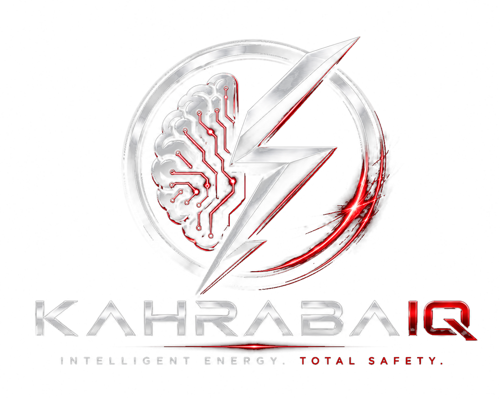
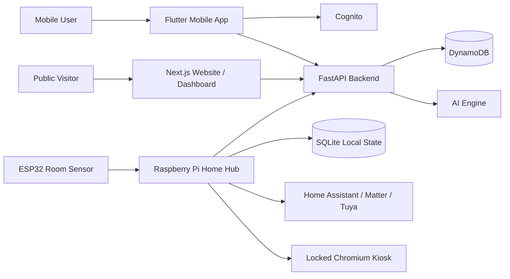

<p align="center">
  
</p>

<p align="center">
  AI-powered smart energy, electrical safety, and local-first home automation.
</p>

<p align="center">
  <a href="KahrabaIQ-website/README.md"></a>
  <a href="KahrabaIQ-mobile-app/README.md"></a>
  <a href="KahrabaIQ-backend/README.md"></a>
  <a href=".github/workflows/ci.yml"></a>
</p>

KahrabaIQ turns a home into a live, intelligent energy system. It combines a Flutter mobile app, AWS-backed FastAPI services, a Raspberry Pi home hub, ESP32 room sensing, a locked kiosk dashboard, and local control through Home Assistant, Matter, and Tuya.

The result is a complete smart-energy prototype that can monitor electrical behavior, detect unsafe conditions, understand occupancy, control connected devices, sync local hardware state to the cloud, and generate AI recommendations from real usage patterns.

## Why KahrabaIQ

Most smart-home systems focus on comfort or basic remote control. KahrabaIQ treats energy, safety, occupancy, automation, and intelligence as one connected system.

It is built for real homes where internet access can be unreliable, sensor data can go stale, electrical devices need local authority, and safety alerts must be fast and explainable.

## Demo Highlights

| Experience | What It Shows |
| --- | --- |
| Live energy dashboard | Power, voltage, current, energy, cost, device state, and room conditions. |
| AI recommendations | Waste detection, anomaly labels, next-hour usage, estimated cost, and actionable suggestions. |
| Safety alerts | Immediate smoke/gas and stale-data warnings without waiting for slower ML cycles. |
| Occupancy awareness | Flags waste when AC, sockets, or lights are active while a room appears empty. |
| Local device control | Cloud commands are queued remotely, then executed by the Pi through local integrations. |
| Secure kiosk mode | The Pi opens a locked dashboard with short-lived kiosk sessions instead of long-lived browser secrets. |
| Demo Scenario Mode | Presentation-safe AI simulations for normal use, AC left on, socket waste, high energy, smoke/gas, and stale data. |
| Bilingual website | A polished English and Arabic product surface built with Next.js. |

## Architecture



### Cloud And Local Responsibilities

| Layer | Owns |
| --- | --- |
| AWS backend | Authentication, app state, homes, users, summaries, command queues, kiosk sessions, AI records, and chatbot APIs. |
| Raspberry Pi | Local sensing, SQLite buffering, first-boot provisioning, kiosk launch, hardware command execution, and cloud sync. |
| ESP32 | Room-level temperature, humidity, light, motion, sound, smoke/gas readings, and local sensor uploads. |
| Flutter app | Authentication, dashboards, device controls, QR pairing, AI insights, roles, and demo scenarios. |
| Next.js website | Public product experience, bilingual presentation, cloud dashboard surface, and kiosk access. |

## Core Capabilities

### Real-Time Energy Intelligence

KahrabaIQ tracks live and historical electrical behavior across connected breakers and smart devices. It stores compact current state for dashboards, hourly and daily summaries for trends, and command history for deeper context.

It can surface current power, voltage, current, energy, estimated cost, daily usage, monthly usage, device-level state, stale data, and waste patterns.

### Electrical Safety And Awareness

The ESP32 room sensor gives the system environmental context. Smoke/gas, temperature, humidity, motion, light, sound, and freshness signals help KahrabaIQ distinguish normal behavior from unsafe or wasteful behavior.

Safety-critical conditions are handled through immediate rules, which keeps urgent alerts responsive and explainable.

### Local-First Hardware Control

The Raspberry Pi is the local authority for hardware. Cloud commands are queued remotely, then pulled and executed by the Pi through Home Assistant, Matter, or Tuya depending on configuration.

This keeps physical device control close to the home while still enabling remote dashboards, mobile access, AI, and administration.

### AI Insights

The backend includes a lightweight AI layer built around the project data model. It combines rule-based guardrails, routine checks, historical summaries, and scikit-learn model artifacts.

Prediction and insight targets include:

- `waste_event`
- `anomaly_label`
- `recommendation_type`
- `next_hour_total_energy_kWh`
- `next_hour_total_cost_BHD`

The AI system runs in layers:

| Level | Purpose |
| --- | --- |
| Level 1 | Immediate safety and obvious system alerts. |
| Level 2 | Routine and anomaly checks using recent history and thresholds. |
| Level 3 | ML prediction after hourly summaries are available. |

### Secure Kiosk Experience

The Pi launches a locked Chromium dashboard after provisioning. The browser never receives the long-lived Pi device token. Instead, the Pi agent exchanges it for a short-lived kiosk session scoped to that Pi and home.

Admin unlock is intentionally limited. It can expose maintenance controls without granting Raspberry Pi OS access, SSH access, root access, or arbitrary sudo permissions.

## Platform Components

| Component | Path | Stack | Purpose |
| --- | --- | --- | --- |
| Mobile app | `KahrabaIQ-mobile-app/` | Flutter, Dart | Authentication, dashboards, device control, QR pairing, AI insights, roles, and demo scenarios. |
| Backend | `KahrabaIQ-backend/` | FastAPI, Python, scikit-learn | Cloud API, Cognito auth, DynamoDB persistence, AI inference, chatbot APIs, command queues, and kiosk sessions. |
| Website/dashboard | `KahrabaIQ-website/` | Next.js, React, TypeScript, GSAP | Bilingual public website, product presentation, dashboard surface, and kiosk access. |
| Raspberry Pi runtime | `pi/` | Python, SQLite, systemd | Local hub services, provisioning, sensor receiving, command execution, summaries, live sync, and kiosk launch. |
| ESP32 firmware | `esp32/` | ESP32, Arduino C | Room sensor firmware, setup hotspot, provisioning API, saved Wi-Fi/Pi config, and periodic sensor uploads. |

## Tech Stack

| Layer | Technologies |
| --- | --- |
| Mobile | Flutter, Dart |
| Web | Next.js 15, React 19, TypeScript, GSAP, responsive CSS |
| Backend | Python, FastAPI, scikit-learn |
| Cloud | AWS, DynamoDB, Cognito, AWS IoT Core, IAM, CloudWatch |
| Edge runtime | Raspberry Pi, SQLite, systemd, Chromium kiosk |
| Firmware | ESP32, Arduino C |
| Smart-home integrations | Home Assistant, Matter, Tuya |

## Repository Map

```text
KahrabaIQ/
  KahrabaIQ-mobile-app/       Flutter mobile application
  KahrabaIQ-backend/          FastAPI backend, AI pipeline, AWS persistence
  KahrabaIQ-website/          Bilingual Next.js website and dashboard surface
  pi/                         Raspberry Pi runtime, provisioning, kiosk, local integrations
  esp32/                      ESP32 firmware and sensor provisioning docs
  .github/workflows/          CI checks
  .env.sample                 Safe root environment template
  README.md                   Project overview
```

## Quick Start

### Backend

```bash
cd KahrabaIQ-backend
python3 -m venv .venv
. .venv/bin/activate
pip install -r requirements.txt
uvicorn api_server:app --reload
```

Health check:

```bash
curl http://127.0.0.1:8000/api/health
```

### Website

```bash
cd KahrabaIQ-website
npm install
npm run dev
```

Open:

```text
http://localhost:3000/en
http://localhost:3000/ar
```

### Mobile App

```bash
cd KahrabaIQ-mobile-app
flutter pub get
flutter run
```

Enable presentation scenarios:

```bash
flutter run \
  --dart-define=ENABLE_DEMO_SCENARIOS=true \
  --dart-define=USE_BACKEND_SCENARIO_AI=true
```

## Hardware Flow

KahrabaIQ supports a guided Pi-led provisioning flow for both the Raspberry Pi and ESP32 sensor.

```text
Pi first boot
  -> setup hotspot
  -> home Wi-Fi connection
  -> backend pairing QR
  -> mobile app scans QR
  -> backend returns home identity
  -> Pi provisions ESP32
  -> ESP32 posts room sensor data to Pi
  -> Pi starts normal services and locked kiosk dashboard
```

Recommended network setup:

```text
wlan0 -> built-in Raspberry Pi Wi-Fi for permanent home network access
wlan1 -> temporary USB Wi-Fi adapter for setup and ESP32 provisioning
```

Detailed provisioning documentation lives in `pi/docs/first-boot-provisioning.md` and `esp32/docs/provisioning-contract.md`.

## Security Model

- The Pi device token stays on the Raspberry Pi in the Pi-local environment file.
- The browser receives only short-lived kiosk sessions.
- Cognito handles mobile authentication.
- The first user who scans a new Pi pairing QR becomes `home_admin`.
- Home admins can invite or remove members/viewers within configured limits.
- Platform admins are configured through backend environment values for global maintenance actions.
- Secrets must live in environment variables, AWS Secrets Manager, SSM Parameter Store, or Pi-local environment files.
- Real API keys, Pi tokens, Tuya secrets, Home Assistant tokens, kiosk secrets, Wi-Fi passwords, and `.env` files must not be committed.

## Environment Configuration

Use `.env.sample` files as safe templates. Keep real production values outside git.

Backend essentials:

```env
STORAGE_BACKEND=aws
AWS_REGION=your_aws_region
AWS_DYNAMODB_APP_TABLE=KahrabaIQApp
AWS_DYNAMODB_SUMMARIES_TABLE=SmartEnergySummaries
PLATFORM_ADMIN_EMAILS=admin@example.com
INTERNAL_SERVICE_TOKEN=change_me_to_a_long_random_secret
KIOSK_SESSION_SECRET=change_me_to_a_long_random_secret
```

Cognito essentials:

```env
COGNITO_USER_POOL_ID=your_user_pool_id
COGNITO_APP_CLIENT_ID=your_app_client_id
COGNITO_IDENTITY_POOL_ID=your_identity_pool_id
```

Pi essentials:

```env
HOME_ID=
PI_ID=your_pi_id
PI_DEVICE_TOKEN=change_me
KAHRABAIQ_API_URL=https://api.example.com
KIOSK_DASHBOARD_URL=https://dashboard.example.com
ESP32_DEVICE_KEY=change_me
HOME_ASSISTANT_URL=http://127.0.0.1:8123
HOME_ASSISTANT_TOKEN=change_me_after_creating_a_long_lived_access_token
REMOTE_COMMAND_SOURCE=ec2
```

## Verification

Backend and Pi Python checks:

```bash
python3 -m py_compile \
  KahrabaIQ-backend/api_server.py \
  KahrabaIQ-backend/aws_cloud_store.py \
  KahrabaIQ-backend/main.py \
  pi/agent/*.py
```

Flutter checks:

```bash
cd KahrabaIQ-mobile-app
flutter analyze
flutter test
```

Website checks:

```bash
cd KahrabaIQ-website
npm run lint
npm run build
```

Repository check:

```bash
git diff --check
```

CI runs project checks through `.github/workflows/ci.yml` on pull requests and branch pushes.

## Documentation

| Document | Covers |
| --- | --- |
| `KahrabaIQ-backend/README.md` | Backend, AI pipeline, chatbot, API behavior, and model scripts. |
| `KahrabaIQ-mobile-app/README.md` | Flutter setup, runtime defines, tests, and Demo Scenario Mode. |
| `KahrabaIQ-website/README.md` | Bilingual Next.js website, content editing, assets, localization, and deployment. |
| `pi/README.md` | Raspberry Pi services, installation, provisioning, kiosk security, Home Assistant, Matter, and command execution. |
| `pi/docs/first-boot-provisioning.md` | Full Pi and ESP32 first-boot provisioning flow. |
| `pi/docs/kiosk-setup.md` | Kiosk setup and troubleshooting. |
| `pi/docs/home-assistant-matter.md` | Home Assistant and Matter integration. |
| `pi/docs/tuya-setup.md` | Tuya setup and fallback control path. |
| `esp32/README.md` | ESP32 firmware behavior and provisioning. |
| `esp32/docs/flashing.md` | Firmware flashing instructions. |
| `esp32/docs/wiring.md` | Sensor wiring and pins. |
| `esp32/docs/provisioning-contract.md` | ESP32 provisioning HTTP API. |

## Current Direction

KahrabaIQ is AWS-backed and local-hardware aware. The cloud owns authentication, app state, AI, summaries, pairing, and command queues. The Raspberry Pi owns local sensing, buffering, kiosk sessions, provisioning, and physical device execution. The ESP32 provides room-level awareness. The Flutter app and Next.js dashboard turn that system into a polished user experience.

KahrabaIQ is a full-stack smart-energy prototype combining cloud intelligence, local resilience, secure hardware control, real sensor data, and a bilingual product surface.
